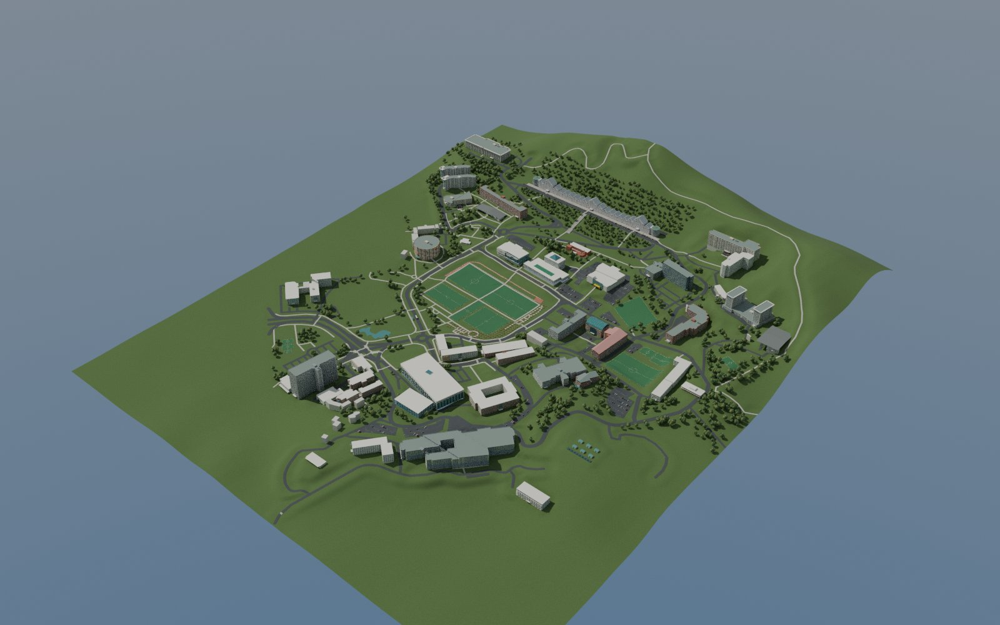

# ai1 · 조선대학교 캠퍼스 모델과 Three.js 탐험 게임

공개 사진, 공식 캠퍼스 지도, OpenStreetMap, 공개 고도 자료를 참고해 만든 캠퍼스 시각화 프로젝트입니다.
Blender 건축 모델과 Three.js 게임은 서로 구분된 프로젝트이며 같은 갱신 자산을 사용합니다.

> 대학 공식 제작물, 측량 성과, BIM, 실제 운행 안내 또는 안전·대피·접근성 안내가 아닙니다.
> 사진으로 확인한 특징과 모델링 추정을 구분합니다. 건물별 근거와 최종 검증 범위는 `references/`, `verification/`에서 확인하세요.

## 미리보기



[건물별 카탈로그](renders/buildings/) · [아침](renders/preview/time_of_day_final/morning.jpg) · [한낮](renders/preview/time_of_day_final/noon.jpg) · [해질녘](renders/preview/time_of_day_final/sunset.jpg) · [야간](renders/preview/time_of_day_final/night.jpg)

## 폴더

- `architecture/`: 본관·캠퍼스·계단·도로·지형·정류장·셔틀·재질·렌더 생성 소스와 입력 데이터
- `game/`: 독립 Three.js 게임, 실행용 정적 파일, 원본 소스와 검증 스크립트
- `artifacts/Chosun_Campus.blend`: 편집 가능한 통합 PBR 모델
- `artifacts/Chosun_Campus_GLB.zip`: 교환용 통합 GLB. 압축을 풀어 사용하세요.
- `renders/buildings/`: 건물별 최종 렌더와 카메라·원본 해시 기록
- `renders/stairs/`: 계단·경사로 보조 상세 렌더 원본
- `renders/overview/`: 최종 통합 모델 조감도 원본
- `renders/preview/`: GitHub 직접 열람용 경량 JPEG
- `renders/time_of_day/`: 같은 카메라의 아침·한낮·해질녘·야간 조명 렌더
- `renders/shuttle/`: 공개 자료로 확인한 셔틀 도색 렌더
- `references/`: 사진 URL, 관찰 사항, 지도·지형 출처 및 근사 한계. 참고 원본 사진/지도 화면은 재배포하지 않습니다.
- `verification/`: 최종 모델·게임 검증 결과

## 대형 파일 복원

전송 안정성을 위해 1MiB 초과 파일은 `asset-parts/`의 작은 gzip 조각으로 저장했습니다. 아래 한 명령이 원본 경로에 복원하고 조각·완성 파일의 SHA-256을 검증합니다. Python 3.9 이상이 필요합니다.

```sh
python3 scripts/restore-assets.py
```

게임 `npm test`와 `npm run serve`도 실행 전에 자동 복원합니다. 원본 크기·해시는 `asset-parts/manifest.json`에서 확인할 수 있습니다.

## 게임 실행

```sh
cd game
npm ci
npm test
npm run serve
```

브라우저에서 `http://localhost:8173`을 엽니다. 실행용 파일은 `game/dist/`에 포함됩니다.
상세 조작법과 추가 회귀검사 명령은 [게임 README](game/README.md)와 [게임 QA](game/QA.md)를 참고하세요.

모델 갱신 스크립트는 `CHOSUN_MODEL_ROOT`를 지원하며 저장소에서는 기본적으로 `../architecture`를 사용합니다.
`game/.openai` 같은 비공개 배포 설정, 자격증명, `node_modules`는 이 공개 소스에 포함하지 않습니다.

## 모델 재생성

Blender 4.3.2와 Noto Sans CJK 한글 폰트로 제작했습니다. 다른 환경에서 한글 표지판을 다시 생성할 때는 Noto CJK를 설치하고 소스의 폰트 경로를 확인하세요. 입력 폴더 구조를 유지한 채 다음 순서로 Blender Python 스크립트를 실행합니다.

```sh
blender -b --python architecture/building/build_building.py
blender -b --python architecture/site/site_builder.py
blender -b --python architecture/transit/build_transit.py
blender -b --python architecture/campus/build_campus.py
blender -b --python architecture/integration/integrate_campus.py
cp architecture/delivery/Chosun_Campus.blend architecture/delivery/Chosun_Campus_Geometry.blend
blender -b architecture/delivery/Chosun_Campus_Geometry.blend --python architecture/materials/apply_pbr_copy.py -- "$PWD/architecture/delivery/Chosun_Campus.blend" "$PWD/architecture/delivery/Chosun_Campus.glb"
```

PBR 처리 및 건물별 렌더는 `architecture/materials/README_PBR_KO.txt`와 `architecture/lighting/`의 스크립트를 참고하세요.
일부 보조 점검·과거 프리뷰 스크립트에는 제작 환경의 절대 경로가 남아 있으므로 별도로 실행하려면 경로를 수정해야 합니다.
도로·지형 캐시를 사용하는 일반 Blender 빌드는 재다운로드가 필요하지 않습니다. 원자료부터 캐시를 다시 만드는 선택적 전처리에는 별도의 Python 공간자료 패키지가 필요할 수 있습니다.

렌더 출처 명세는 제작 당시 `delivery/` 폴더명을 보존합니다. 이 저장소의 대응 폴더는 `building_catalog → renders/buildings`, `time_of_day_final → renders/time_of_day`, `final_overview → renders/overview`, `stair_details_final → renders/stairs`입니다. 건물 69장 중 41장은 최종 모델에서 재촬영했고, 28장은 변화 영향권 밖의 기존 사진을 실제 원본 해시와 뷰 영역 동일성 검증 기록과 함께 보존했습니다.

## 정확도와 표현 범위

- 본관, 도서관, 국제관, 체육대학, 솔마루, 해오름관, 치과대 복합동 등은 공개 사진의 외관 특징과 공식 층별 안내를 대조했습니다.
- 외관 사진을 확인하지 못한 소형 부속동은 지도 발자국 기반의 단순 추정 매스입니다. 이를 사진 검증된 건물과 동일한 정확도로 취급하지 마세요.
- 지형은 약 30m Copernicus DSM의 경향을 이용한 상대 지형입니다. DSM에는 수목·건물이 포함됩니다. 본관 근접 지형 보존, 건물 마스크, 부지 패드, 도로 종단과 보행 연결 보정이 포함되어 실제 측량 지면과 다릅니다.
- 사진 확인 계단과 고도차를 이어 주기 위해 만든 **추정 보행 연결 계단**은 별도 컬렉션·메타데이터로 구분합니다. 추정 계단이 실제 현장에 존재한다는 의미가 아닙니다.
- 횡단보도 위치는 지도와 일부 위성·거리뷰 대조를 사용했습니다. 모든 횡단보도의 폭·턱낮춤을 현장 측정한 것은 아닙니다.
- 셔틀 도색은 2025년 공식 교지와 2026년 대학신문 사진을 참고했습니다. 보이지 않는 반대편은 대칭 추정이며, 현재 모든 차량이 같은 모습이라는 보장은 없습니다. 게임의 속도·정차 시간은 실제 배차와 다릅니다.
- Blender의 절차적 PBR과 게임·GLB의 가벼운 PBR 표현은 다릅니다. 저폴리 수목과 미모델링 실내의 한계가 남습니다.
- 시간대 렌더는 조명 연출입니다. 특정 날짜의 일조 분석이나 실제 창문·가로등 점등 상태를 재현하지 않습니다.
- 자동 Node 시뮬레이션 통과는 실제 브라우저·WebGL·iPhone 성능 검증을 의미하지 않습니다. 실행·미실행 검증은 최종 보고서에 구분합니다.

## 출처·권리

Map data © OpenStreetMap contributors, [ODbL 1.0](https://www.openstreetmap.org/copyright).
지도 파생 윤곽·좌표·도로 데이터의 이용과 재배포에는 해당 라이선스 및 표시를 유지하세요.

공식 캠퍼스 안내: https://www3.chosun.ac.kr/campusMap/chosun/view.do
지형 자료의 출처·라이선스·전처리 방법은 `references/chosun_detail_refs/terrain/README.md`에 있습니다.
Three.js, meshoptimizer 등의 원 라이선스는 `game/LICENSES.md`와 `game/dist/vendor/`에 유지됩니다.
대학 참고 사진과 지도 화면은 관찰용으로만 사용했으며 원본 사진·화면·텍스처로 재배포하지 않습니다.

Noto CJK 폰트와 기타 포함 소프트웨어의 라이선스는 [THIRD_PARTY_NOTICES.md](THIRD_PARTY_NOTICES.md)에 정리했습니다.
