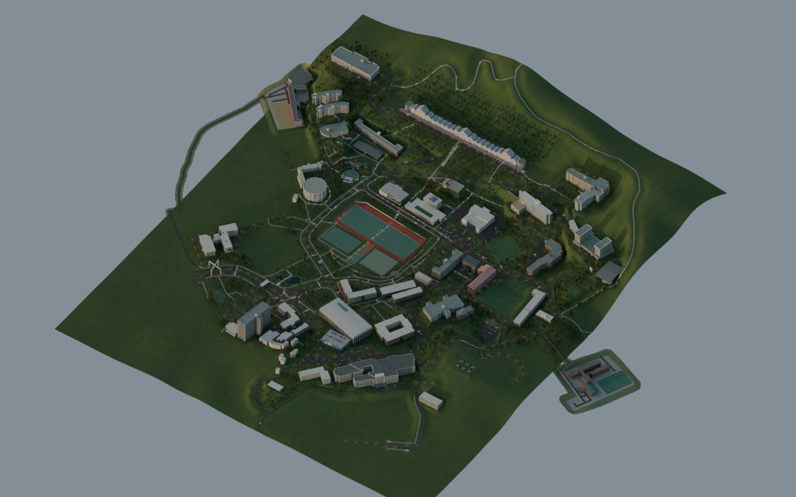

# ai1 · 조선대학교 캠퍼스 모델과 Three.js 탐험 게임

공개 사진·대학 캠퍼스 지도·OpenStreetMap·공개 고도 자료를 참고한 캠퍼스 시각화 프로젝트입니다. 편집 가능한 Blender 모델, 웹 탐험 게임, 생성 소스와 검증 기록을 함께 보관합니다.

> 대학 공식 제작물, 실측 BIM, 실제 운행 안내 또는 안전·피난·접근성 안내가 아닙니다. 건물·지형·조명 위치에는 모델링 추정이 포함됩니다.

## 최신 변경: 가로등 v6

- 상세 지형·건물·주차빌딩·출입구·정류장 모델에 외부 등기구 **536개**를 추가했습니다: 도로 310, 보행로 145, 계단 25, 주차 공간 46, 정류장 10.
- 최종 native는 기존 **7,923개 객체를 보존**하고 등기구 536개와 Blender 광원 536개를 더한 **8,995개 객체**입니다. 편집 파일은 `artifacts/Chosun_Campus_Street_Lighting_v6.blend`입니다.
- 게임은 기존 건물·캠퍼스 웹 GLB에 작은 `lighting.glb`를 추가합니다. 걷기·운전·NPC 대화와 낮·저녁·야간 전환을 지원합니다. 근거리 실시간 조명은 기본 꺼짐이며, 켜도 그림자 없는 광원을 최대 4개만 사용합니다.
- 최종 저녁·야간·정류장 상세 렌더와 native/게임 결속 계약을 포함합니다. 원본 자산의 SHA-256과 복원 조각 검증을 제공합니다.

## 미리보기



[야간](renders/preview/street_lighting_v6/Street_Lighting_night.jpg) · [정류장 상세](renders/preview/street_lighting_v6/Street_Lighting_detail.jpg) · [원본 PNG](renders/street_lighting_v6/) · [기존 건물 카탈로그](renders/buildings/)

미리보기는 Blender 렌더이며 게임 브라우저 화면이 아닙니다. 원본 PNG는 아래 복원 명령으로 생성됩니다. 이전 건물·시간대 카탈로그는 가로등 추가 전 기록으로 보존합니다.

## 받기와 대형 파일 복원

GitHub 저장소를 clone하거나 ZIP으로 내려받아 압축을 푸세요. **Python 3.11 이상**을 권장합니다(릴리스 검증기는 `hashlib.file_digest` 사용). 대형 파일은 `asset-parts/`에 gzip 조각으로 보관하므로 먼저 저장소 최상위에서 실행합니다.

```sh
python3 scripts/restore-assets.py
```

`asset-parts/manifest.json`의 크기·조각·완성 파일 SHA-256을 검사해 원래 경로로 복원합니다. 최신 native 자체는 **276,659,952 bytes**이며 전체 저장소·복원 결과를 위한 충분한 디스크 공간이 필요합니다. 기존 복원 스크립트는 해시가 다른 대상 파일을 교체하므로, 직접 편집한 모델·자산은 먼저 다른 이름으로 보관하세요.

최신 native SHA-256:

```text
563bc543278531cc636cb295b644b8ffe0e28acc151fe4934435c360d94192f8
```

`artifacts/Chosun_Campus.blend`와 `artifacts/Chosun_Campus_GLB.zip`은 이전 단계의 보존본입니다. 최신 모델과 혼동하지 마세요. 새 원본 GLB 두 개는 `architecture/lighting/inputs/raw_glb/`에 복원됩니다. 웹용 압축 GLB와 편집·내보내기 원본 GLB는 용도가 다릅니다.

## 게임 실행

복원 후 정적 서버만으로 실행할 수 있습니다. 외부 CDN이나 npm 설치는 플레이에 필요하지 않습니다.

```sh
python3 -m http.server 8173 --directory game/dist
```

브라우저에서 `http://localhost:8173`을 엽니다. WebGL 2가 필요하며 `index.html`을 파일로 직접 열면 안 됩니다.

개발·검증에는 Node.js와 npm을 사용합니다.

```sh
cd game
npm ci
npm run verify:release
npm run serve
```

검증된 납품 상태를 보존하려면 `npm test`, `npm run test:lighting` 등 재검사는 **별도 복사본**에서 실행하세요. 일부 검사는 실행 시간·메모리 수치를 포함한 결과 JSON을 덮어쓰며, 그 뒤 원래 영수증 해시를 검사하는 `verify:release`는 실패할 수 있습니다. 먼저 원본 상태에서 `verify:release`를 실행하고, 결과 파일이 바뀌면 검증된 원본과 구분해서 보관하세요.

`npm test`/`npm run serve`의 사전 검사는 실행 GLB 해시를 확인하며, 없어진 GLB만 일치하는 조각에서 복원합니다. 데이터·vendor 등 모든 대형 파일을 준비하려면 **처음의 전체 복원 명령을 먼저 실행**하세요. `npm run test:all`은 광범위한 기존 회귀 검사 명령이며 모든 알려진 진단이 성공한다는 보장은 아닙니다.

- WASD/방향키: 이동·운전, 마우스/드래그: 시선
- Shift: 달리기, Space: 차량 브레이크, E: NPC 대화·탐험 차량 탑승/하차
- 시간대 버튼/도움말: 낮·저녁·야간, 근거리 조명 선택
- 모바일 조작 UI는 포함하지만 실기기 성능·조작 검증은 완료하지 않았습니다.

자세한 기능과 조작은 [게임 README](game/README.md), 검증 범위와 수치 한계는 [게임 QA](game/QA.md)를 참고하세요.

## 구조와 편집

| 경로 | 내용 |
| --- | --- |
| `game/dist/` | 바로 실행하는 Three.js 게임 코드·웹 자산·라이선스 |
| `game/scripts/`, `game/data/`, `game/tests/` | 자산 처리·입력 데이터·검사 소스와 증거 |
| `game/revision/` | 기존 소스 보존본, 가로등 계약과 최종 native 결속 |
| `architecture/lighting/street_lighting_v6/` | 가로등 생성·보존·렌더 스크립트와 최종 계약/검증 |
| `architecture/lighting/inputs/raw_glb/` | 가로등 설계 기준 원본 건물·캠퍼스 GLB |
| `architecture/`의 나머지 폴더 | 기존 건축·지형·도로·교통·재질 생성 소스 및 참고 데이터 |
| `artifacts/` | 복원되는 편집용 native와 기존 교환 파일 |
| `renders/` | 최종 가로등 렌더와 보존된 이전 건물별 카탈로그 |
| `references/`, `licenses/` | 모델 근거·지도/고도 출처·재배포 라이선스 |
| `asset-parts/`, `scripts/restore-assets.py` | 대형 자산의 무손실 분할 저장과 해시 검증 복원 |

게임 소스를 ZIP 안에만 숨기지 않고 직접 수정 가능한 파일로 보관합니다. `game/LIGHTING_SOURCE_MANIFEST.json`은 최신 소스의 정확한 해시 목록이며, `game/SOURCE_MANIFEST.json`은 그 기준이 된 이전 단계 기록입니다.

Blender 4.3.2로 제작했습니다. 최신 native를 열어 편집하는 작업과 원자료에서 모델 전체를 재생성하는 작업은 다릅니다. 가로등을 처음부터 다시 생성하려면 정확한 기반 native `a65c2ae19f02c59f655e0c7eedb2482a5c2f6a9c53bb94f2425769dbd4417fbd`가 추가로 필요하며, **이 게시본의 v6 파일로 대체할 수 없습니다**. 기존 `architecture/` 초기 생성 파이프라인이 최신 모델 전체를 곧바로 재현한다고 주장하지 않습니다. 자세한 입력·경로·메모리 조건은 [가로등 소스 안내](architecture/lighting/street_lighting_v6/README.md)를 참고하세요.

한글 표지판 재생성에는 Noto Sans CJK 폰트가 필요합니다. 일부 과거 검증·제작 스크립트와 결과에는 당시 절대 경로가 남아 있으므로 재실행 시 자신의 경로와 입력 해시를 확인하세요.

## 검증과 남은 한계

2026-10-11 저장소 패키지에서 전체 자산 복원·최신 게임 500개 소스의 해시 결속·가로등 67개 단위 검사 및 국소 배치 검사를 다시 확인했습니다. 새 실행 범위와 의존성 준비 한계는 [게시 검증 기록](verification/lighting-v6-publication.json)에 구분합니다.

- 보존된 최종 검증: 가로등 단위 검사 **67개**, 새 등기구와 기존 보행·도착점·차량·셔틀 경로의 **국소 간섭 검사** 통과. native 재열기 후 원본 객체·메시 보존 및 최종 게임 계약 결속을 확인했습니다.
- 검사 영수증과 실제 재실행을 구분합니다. 가로등 추가 시 기존 전체 캠퍼스 Octree 이동 회귀를 전부 재실행한 결과는 아닙니다. 자세한 입력 해시와 범위는 `game/tests/FINAL_VALIDATION.json` 및 `game/QA.md`에 있습니다.
- 브라우저/WebGL/GPU·모바일 성능·전체 UI 흐름·게임 야간 화면 픽셀 가독성은 미검증입니다. Node CPU 검사는 실제 화면 FPS 측정이 아닙니다.
- 셔틀은 7개 정류장의 편도 시연 후 종점에서 대기합니다. 반복 회차는 구현하지 않았습니다. 기존 타이어 접촉·선택적 경로 진단 한계도 유지되며, 모든 충돌 문제가 해결되었다는 의미가 아닙니다.
- 조명 위치·광도와 일부 건물·주차장·지형은 추정입니다. 측량·조도 인증·실제 시설 운영 상태를 나타내지 않습니다. Blender 렌더의 조명과 웹용 저비용 표현은 다릅니다.

이 GitHub 갱신과 별도 호스팅 Site의 배포는 서로 다른 작업입니다. 저장소 업데이트가 기존 라이브 Site에 자동 적용되었다고 가정하지 마세요.

## 출처·권리

Map data © OpenStreetMap contributors, [ODbL 1.0](https://www.openstreetmap.org/copyright). 지도 파생 윤곽·좌표·도로 데이터의 이용·재배포 시 해당 라이선스와 표시를 유지하세요.

- [조선대학교 공식 캠퍼스 안내](https://www3.chosun.ac.kr/campusMap/chosun/view.do)
- 지형: `references/chosun_detail_refs/terrain/README.md`의 Copernicus DSM 출처·전처리·한계
- Three.js·meshoptimizer 등: [게임 라이선스](game/LICENSES.md)와 `game/dist/vendor/`
- 폰트·포함 소프트웨어: [THIRD_PARTY_NOTICES.md](THIRD_PARTY_NOTICES.md)

대학 참고 사진·지도 화면은 관찰용이며 해당 원본을 텍스처나 이미지로 재배포하지 않습니다. NPC·대화·탐험 차량은 게임용 창작입니다.
