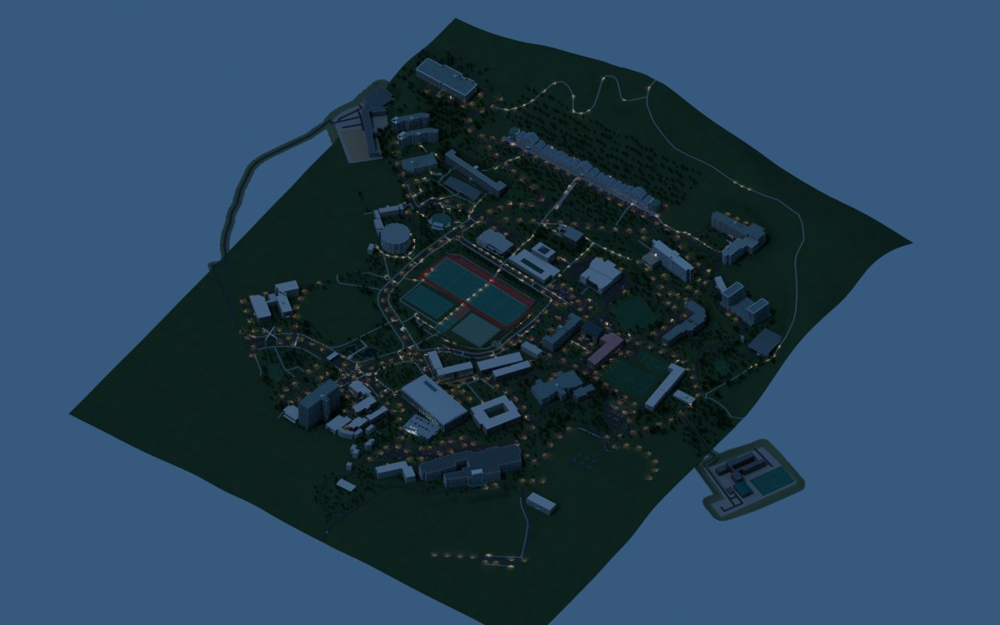
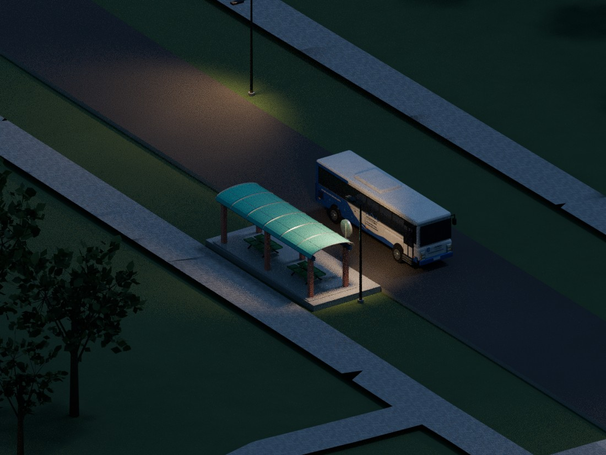

# 조선대학교 캠퍼스 가로등 v6

기존 a65 캠퍼스에 따뜻한 외부 조명을 추가한 Blender·게임 공통 설계입니다. 위치와 빛의 세기는 추정값이며 현장 설치도, 실측 조도 또는 전력 소비량을 뜻하지 않습니다.

## 변경과 기록된 검증

- 기존 객체 7,923개 보존, 등기구 536개와 Blender 광원 536개 추가
- 배치: 도로 310개, 보행로 145개, 계단 25개, 외부 주차구역 46개, 대중교통 대기지점 10개
- 최종 native 재개방·원본 보존·유한 지면 배치 검사 통과 기록 포함
- 게임 조명 검사: 67개 단위 검사, 보행 구간 7,008개, 목적지 54개, 차량 자세 72,723개, 셔틀 자세 11,068개에서 새 기둥 접촉 0건 기록
- 기존 캠퍼스 전체 물리 회귀의 신규 실행, 실제 브라우저 WebGL·GPU·모바일 성능·게임 야간 화면 검증은 포함하지 않음

`qa/`는 해당 버전 제작 당시의 검사 기록입니다. 이번 저장소 정리에서 같은 검사를 새로 실행했다는 뜻은 아닙니다. 기록에는 당시 절대 경로와 별도 보관 산출물 참조가 남아 있으며, 모든 과거 실행 환경을 그대로 제공하지는 않습니다. 이전에 유실된 배치 좌표와 동일하다고 주장하지 않습니다.

## 파일

- `scripts/`: 원본 배치·제작·보존·렌더 스크립트
- `contracts/street_lighting_manifest.json`: 동결된 배치 계약
- `lighting_manifest.json`: 최종 native·게임 결속 정보
- `exports/lighting.glb`: 등기구 전용 추가 자산, 241,408 bytes
- `artifacts/Chosun_Campus_Street_Lighting_v6.blend`: 자산 복원 명령으로 생성되는 최종 native. 캠퍼스와 새 조명이 함께 있으며 분할 조각은 저장소의 `asset-parts/`에 보관합니다.
- [`../../../renders/street_lighting_v6/`](../../../renders/street_lighting_v6/): 원본 PNG 3장(자산 복원 후 사용)

원본 캠퍼스·건물 GLB는 a65 자산을 유지합니다. 게임은 별도 등기구 GLB와 시각적 바닥 빛을 추가하며, 빛 표현을 보행·차량 지지면으로 사용하지 않습니다. 근거리 실시간 조명은 선택 시 그림자 없는 광원을 최대 4개 사용합니다.

## 원본 모델과 재현 조건

최종 native SHA-256:

`563bc543278531cc636cb295b644b8ffe0e28acc151fe4934435c360d94192f8`

추가 조명 제작에 필요한 원본 a65 native SHA-256:

`a65c2ae19f02c59f655e0c7eedb2482a5c2f6a9c53bb94f2425769dbd4417fbd`

원본 a65 native는 이 조명 추가분에 포함되어 있지 않습니다. 최종 v6 파일을 원본 a65 대신 넣으면 안 됩니다. `build` 실행에는 정확한 a65 파일을 `architecture/lighting/inputs/Chosun_Campus_Realism_v2.blend`에 준비해야 하며, 해시 검사를 통과해야 합니다. 원본의 raw GLB, 게임 데이터, Python 패키지와 Blender 실행 환경도 해당 스크립트의 입력 조건을 충족해야 합니다.

최종 모델을 재개방하거나 렌더할 때는 저장소의 대용량 자산 복원 절차를 먼저 마친 뒤 `artifacts/Chosun_Campus_Street_Lighting_v6.blend`를 이 폴더의 `Chosun_Campus_Street_Lighting_v6.blend`로 복사할 수 있습니다. `scripts/run_native_step.py`는 Linux의 `/usr/bin/blender`와 메모리 확인을 사용합니다. 실행 전 여유 메모리 5,600 MiB 이상을 요구하고 실행 중 1,250 MiB 아래로 내려가면 자기 프로세스만 중단합니다. 제작 스크립트는 기존 최종 출력 덮어쓰기를 거부하므로 재제작은 별도 작업 사본에서 진행하세요.

## 이미지

원본 PNG는 Blender 4.3.2의 Cycles CPU 렌더입니다. 저녁·야간 전경은 256 samples, 정류장 상세는 1,024 samples이며 denoising을 사용하지 않아 일부 입자가 남습니다. 렌더용 카메라·환경·노출 변경은 native에 저장하지 않았습니다. JPEG는 원본 PNG에서 변환한 미리보기입니다.

